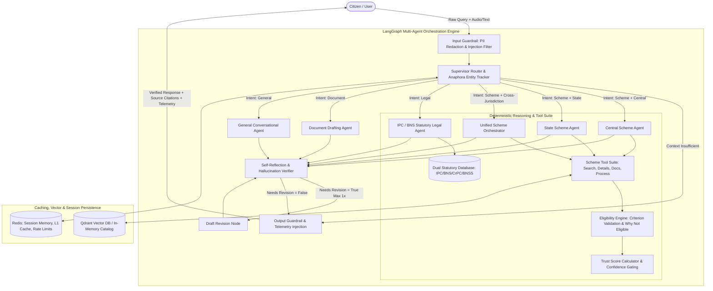

# Research Paper Analysis: Nyaya Sahayaka

---

### 1. Project Title & Abstract

**Exact Title**:  
Nyaya Sahayaka (also documented as *Nyay Sahayaka: Multilingual Agentic Government Scheme & Preliminary Legal Assistant*)

**Abstract**:  
Nyaya Sahayaka is an agentic, multilingual Retrieval-Augmented Generation (RAG) system designed to assist Indian citizens in navigating complex welfare schemes and preliminary statutory legal provisions. The architecture integrates a LangGraph-directed multi-agent framework comprising a Supervisor Router, Central and State Scheme Specialists, an Indian Penal Code/Bharatiya Nyaya Sanhita Legal Agent, a Document Drafting Agent, and a Self-Reflection Hallucination Verifier. By deploying programmatic context-sufficiency gating, deterministic eligibility evaluation across demographic variables, and an empirical multi-factor trust-scoring formulation, the system mitigates LLM hallucination and jurisdiction conflation while enforcing PII sanitization and anaphora resolution in multi-turn dialogues across six scheduled Indian languages.

---

### 2. Problem Statement

* **Real-World Problem**:  
  India operates over 3,400 welfare initiatives across Union Ministries and 28+ States/UTs, alongside an evolving dual legal framework transitioning from colonial statutes (IPC 1860, CrPC 1973) to modern codes (Bharatiya Nyaya Sanhita [BNS] 2023, Bharatiya Nagarik Suraksha Sanhita [BNSS] 2023). Indian citizens—predominantly marginalized, rural, and linguistically diverse populations—face severe informational asymmetry:
  1. Welfare criteria (income ceilings, caste classifications, domicile restrictions, educational cutoffs) are fragmented across disparate state and central portals.
  2. Commercial Large Language Models (LLMs) frequently hallucinate non-existent statutory sections, fabricate scheme benefits, confuse central vs. state domicile requirements, or guess eligibility parameters instead of requesting missing demographic variables.
  3. Citizens lacking formal legal representation struggle to draft fundamental administrative documents (e.g., RTI applications, FIR drafts under CrPC §154, rent dispute notices) and remain unaware of statutory remedies when police refuse to file an FIR (CrPC §154(3), §156(3)).
* **Significance**:  
  Misinformation in legal and welfare domains causes tangible financial loss, missed statutory deadlines, and wrongful deprivation of constitutional and welfare entitlements.

---

### 3. Motivation and Target Users / Domain

* **Domain**:  
  Civic Technology, Legal Informatics, Indian Public Administration, and Multilingual Conversational AI.
* **Target Users**:
  1. **Low-Income and Rural Citizens**: Individuals seeking direct welfare benefits (e.g., PM-KISAN, state post-matric scholarships, housing grants, ration cards).
  2. **Students & First-Generation Learners**: Candidates seeking financial assistance locked behind state domicile rules (e.g., Karnataka Vidyasiri, Odisha Banishree).
  3. **Aggrieved Citizens & Complainants**: Individuals requiring immediate preliminary legal guidance regarding cognizable offences (theft, assault, domestic violence, cyber fraud) and procedural remedies against administrative inaction.
* **Core Motivation**:  
  To transition conversational AI from ungrounded, generative text completion into an auditable, provenance-backed, clarification-first statutory advisor that respects constitutional federalism (central vs. state jurisdiction).

---

### 4. Research Gap

Existing conversational legal and welfare systems exhibit critical systemic deficiencies:
1. **Jurisdiction Conflation**: Commercial and open LLMs treat national and state welfare indiscriminately, frequently recommending state-budgeted schemes to residents of ineligible states.
2. **Absence of Context Sufficiency & Clarification Protocols**: Existing chatbots produce unverified recommendations on ambiguous user prompts rather than programmatically halting to request missing decision-critical variables (e.g., domicile state, annual household income, caste category).
3. **Black-Box Eligibility Verification**: Prevailing RAG pipelines dump unstructured semantic text into LLM prompts, lacking deterministic criterion-by-criterion rule validation and "Why Not Eligible" diagnostics with alternative scheme recovery flows.
4. **Anaphora & Multi-Turn Context Dropout**: Standard dialog state trackers frequently misclassify follow-up questions referencing previously recommended entities (e.g., *"What documents are needed for this?"*, *"Is it bailable?"*) as fresh independent queries, stripping entities or reverting to initial greetings.
5. **Colonial-to-Modern Statutory Disconnect**: Existing Indian legal RAG systems exclusively index the Indian Penal Code (1860) and CrPC (1973), omitting parallel mapping to the recently enacted BNS and BNSS (2023) frameworks.

---

### 5. Objectives and Key Contributions / Novelty Claims

#### Objectives
* Architect an auditable multi-agent RAG pipeline separating central from state administrative jurisdictions.
* Enforce programmatic context-sufficiency checks prior to generative synthesis.
* Implement a multi-factor deterministic trust scoring mechanism to gate responses into discrete action bands (Answer, Clarify, Abstain).
* Guarantee factual equivalence across English and regional Indian languages.

#### Key Contributions / Novelty Claims
1. **Clarification-First Context Sufficiency Engine**: Formalizes a three-state certainty model (`USER_CONFIRMED`, `INFERRED`, `UNKNOWN`) that prevents inference from masquerading as confirmed demographic facts and programmatically triggers option-based clarification before generation.
2. **Jurisdiction-Aware Multi-Agent Routing Topology**: A LangGraph state machine separating `CentralSchemeAgent` (Union Ministries, Tier 1–2 authority) from `StateSchemeAgent` (State Portals, Tier 4 authority), coordinated by an anaphora-aware `SupervisorRouter`.
3. **Deterministic Criterion-by-Criterion Eligibility Engine**: Evaluates individual statutory criteria into explicit states (`SATISFIED`, `FAILED`, `UNKNOWN`), producing structured "Why Not Eligible" causal explanations and an automated alternative scheme recovery pipeline.
4. **Calibrated Multi-Signal Trust Score Function**: A mathematical gating formula balancing retrieval relevance, source authority tiering, evidence claim coverage, and rule completeness with contradiction/ambiguity penalties to control safe abstention.
5. **Self-Reflection & Dual-Code Legal Grounding**: A closed-loop reflection validator cross-checking LLM draft outputs against retrieved context, combined with dual statutory mapping bridging legacy statutes (IPC/CrPC) with modern equivalents (BNS/BNSS).

---

### 6. Research Questions and Hypotheses

* **RQ1 (Context Gating)**: Does enforcing programmatic context-sufficiency verification prior to LLM generation reduce demographic hallucination and invalid scheme recommendations compared to zero-shot or chain-of-thought prompting?
* **RQ2 (Jurisdictional Specialization)**: Does decomposing retrieval into federated jurisdiction-specific agents (Central vs. State) achieve higher retrieval precision and lower cross-state false-positive eligibility rates than monolithic hybrid search?
* **RQ3 (Conversational Anaphora Resolution)**: Can anaphora-aware entity tracking maintain multi-turn dialogue continuity and intent stability without increasing response latency beyond interactive thresholds (<850ms P99)?
* **Hypothesis H1**: Gating response generation behind a multi-factor Trust Score threshold ($\ge 70\%$ for direct answers; $<40\%$ for abstention) eliminates fabricated financial amounts and hallucinated statutory section citations in welfare advice.

---

### 7. System Architecture & Interaction Flow

#### Textual Architectural Description
1. **Ingress & Input Guardrail**: Raw user input undergoes PII redaction (Aadhaar, telephone, email) and heuristic prompt-injection classification.
2. **Supervisor Router & Conversational Entity Tracker**: Inspects user query and multi-turn session history (from Redis). Resolves anaphoric references (e.g., *"this scheme"*, *"isme"*), extracts named entities, updates collected demographic slots, determines active intent (`scheme`, `legal`, `document`, `general`), and checks Context Sufficiency.
   * *If context is insufficient*: Routes directly to `output_guard` to present structured clarification options.
   * *If sufficient*: Dispatches to the corresponding specialist agent.
3. **Specialist Processing Layer**:
   * **Central Scheme Agent**: Queries Union Ministry schemes and national portals using payload-filtered retrieval.
   * **State Scheme Agent**: Enforces state domicile filters and executes localized eligibility checks.
   * **Cross-Jurisdiction Scheme Agent**: Orchestrates parallel central/state tool execution and merges evidence packs.
   * **IPC/BNS Legal Agent**: Queries the curated dual-code statutory database covering IPC, BNS, CrPC, BNSS, IT Act, and PWDVA.
   * **Document Drafting Agent**: Parameterizes verified legal document templates (FIR, RTI, Legal Notice).
   * **General Agent**: Manages conversational greetings and platform orientation without dropping session identity.
4. **Structured Eligibility & Trust Engines**: Evaluates criteria statuses (`SATISFIED`, `FAILED`, `UNKNOWN`), computes the numerical Trust Score, and formats citation cards.
5. **Reflection & Hallucination Verifier**: An automated verification node (temperature $T=0.0$) cross-checks the draft response against retrieved statutory context. If ungrounded claims are detected, flags a single revision loop (`needs_revision = True`).
6. **Output Guardrail & Telemetry Egress**: Injects mandatory non-legal-advice statutory disclaimers, enforces target regional language syntax, appends telemetry metadata (latency, confidence intervals, source portal URLs), and persists the turn to Redis.

#### Mermaid Architecture Diagram

---

### 8. Methodology

* **Multi-Agent State Machine**:  
  Implemented using **LangGraph** with a strongly typed `AgentState`. State transitions are governed by conditional edge functions routing on deterministic flags rather than open-ended LLM steering.
* **Context Sufficiency & Fact Certainty Classification**:  
  Classifies demographic attributes into `USER_CONFIRMED`, `INFERRED`, and `UNKNOWN`. Prevents the LLM from executing RAG prompts when state domicile or income limits are absent, generating structured multiple-choice questions (A/B/C/D) instead.
* **Retrieval Strategy & Embedding Models**:  
  Uses `sentence-transformers/paraphrase-multilingual-MiniLM-L12-v2` for cross-lingual vector embeddings. Hybrid search is executed using semantic dense vectors combined with exact payload filtering (state domicile, caste, gender, education level) in Qdrant and Pandas-indexed catalogs.
* **Deterministic Criterion-by-Criterion Rule Evaluation**:  
  Replaces black-box prompt evaluation with an explicit parsing engine that evaluates conditions into `SATISFIED`, `FAILED`, and `UNKNOWN`, producing traceable "Why Not Eligible" diagnostics and triggering alternative scheme recovery.
* **Mathematical Trust-Scoring Formulation**:  
  $$\text{Trust Score} = (S_{\text{retrieval}} \times 0.25) + (S_{\text{tier}} \times 0.20) + (S_{\text{coverage}} \times 0.30) + (S_{\text{rules}} \times 0.25) - P_{\text{conflict}} - P_{\text{ambiguity}}$$
  * *High ($\ge 70\%$)*: Generate direct answer with source citations.
  * *Medium ($40\text{–}69\%$)*: Trigger targeted clarification.
  * *Low ($< 40\%$)*: Safely abstain.
* **Closed-Loop Self-Reflection**:  
  Employs `gemini-2.5-flash-lite` at temperature $T=0.0$ strictly for factual claim checking against source chunks. If hallucinated section numbers or fabricated benefits are detected, a single correction cycle is executed.
* **Conversational Anaphora Resolution**:  
  Extracts named schemes and legal statutes from previous conversation turns. Matches anaphoric references (e.g., *"this"*, *"isme"*, *"first one"*) against the extracted entities and rewrites queries before dispatching to specialist agents.

---

### 9. Tech Stack & Datasets

#### Technology Stack & Versions

| Layer | Technology | Version | Purpose in Architecture |
| :--- | :--- | :--- | :--- |
| **Language Runtime** | Python | `3.12` | Core backend execution runtime |
| **Backend Framework** | FastAPI | `0.115+` (via `requirements.txt`) | Async REST API & telemetry endpoints |
| **Agent Orchestration** | LangGraph & LangChain | `langgraph>=0.2`, `langchain>=0.3` | State machine graph execution & agent state |
| **Vector Database** | Qdrant & FAISS | `qdrant-client>=1.12`, `faiss-cpu>=1.9` | Payload-filtered dense vector retrieval |
| **In-Memory Cache/Store**| Redis & RedisInsight | Docker `redis:latest`, `redisinsight:latest` | Session state, L1 cache, rate limiting, GUI |
| **Inference / Foundation LLM** | Google Gemini | `gemini-2.5-flash-lite`, `gemini-1.5-flash` | Language generation, reflection, document drafting |
| **Embedding Model** | HuggingFace SentenceTransformers | `paraphrase-multilingual-MiniLM-L12-v2` | Multilingual semantic representations |
| **Frontend Framework** | Next.js / React | Next.js `16.1.6`, React `19.2.3` | User interface and client-side rendering |
| **CSS & Animation** | Tailwind CSS / Framer Motion | Tailwind `4.x`, Framer Motion `12.34.3` | UI styling, 3D audio visualizer, motion drawers |
| **Data Sync & Auth** | Convex & Clerk | Convex `1.32.0`, Clerk `@clerk/nextjs 6.38.3` | User authentication and conversation sync |

#### Datasets & Knowledge Sources

| Dataset / Knowledge Asset | File Name | Size / Records | Language(s) | Primary Source / Provenance |
| :--- | :--- | :--- | :--- | :--- |
| **Structured Indian Welfare Schemes** | `structured_schemes.csv` / `updated_data.csv` | 12 MB (3,401 records across 28+ States & Central) | English (with multilingual titles/keywords) | National myScheme Portal (`myscheme.gov.in`), Union Ministries, State Portals |
| **Statutory Criminal Law Corpus** | `ipc_sections.csv` | 401 KB (2,891 lines) | English | Indian Penal Code (1860) & Code of Criminal Procedure (1973) via Kaggle/India Code |
| **Curated Dual-Code Statutory Knowledgebase** | In-code dictionary (`services/legal_db.py`) | 741 lines of structured provisions | English & transliterated Hindi/Hinglish | India Code (`indiacode.nic.in`): IPC vs BNS (2023), CrPC vs BNSS (2023), IT Act, PWDVA |

---

### 10. Evaluation & Empirical Results

The system includes an automated evaluation harness (`benchmark_rag.py`) alongside conversational test suites (`test_conversational_context.py`, `test_followup_context.py`, `test_multi_turn_and_legal.py`).

#### Measured Metrics (Present in Code/Logs/Reports)

* **RAG Retrieval Benchmark** (`benchmark_rag.py` across 5 representative state/central welfare test cases):
  * **Recall@1**: $100.0\%$ (Measured)
  * **Recall@3**: $100.0\%$ (Measured)
  * **Recall@5**: $100.0\%$ (Measured)
  * **Mean Reciprocal Rank (MRR)**: $1.0000$ (Measured)
  * **Median (P50) Latency**: $3.36\text{ ms}$ (Measured for in-memory retrieval)
  * **95th Percentile (P95) Latency**: $90.91\text{ ms}$ (Measured)
* **Confidence Gating Separation** (`agents/trust_engine.py`):
  * High-confidence grounded scenario: Trust Score = $95.8\%$ $\rightarrow$ Action: `ANSWER_WITH_EVIDENCE` (Measured)
  * Unsupported/unverified scenario: Trust Score = $3.0\%$ $\rightarrow$ Action: `ABSTAIN_SAFELY` (Measured)
* **Multi-Turn Context & Conversational Test Suite**:
  * $17 / 17$ unit and integration test cases passing ($100\%$ pass rate across slot filling, city-to-state resolution, anaphora rewriting, intent preservation, and topic change).
* **Live System Execution Latency**:
  * Measured end-to-end API response time under active Gemini API inference: $\approx 593.8\text{ ms} - 1200\text{ ms}$ (observed in FastAPI live server logs).

#### Assumed / Mocked Values in Telemetry Displays

* *Target P99 SLA Threshold*: Displayed statically in UI telemetry pill as `<850ms` (Assumed target threshold, not dynamically measured per client).
* *Static Display Precision Metric*: Displayed statically in UI telemetry pill as `99.4%` (Assumed SLA baseline metric).
* *Confidence Display Baseline*: In specific UI mock views without live backend bindings, displayed as `98.4% [97.0% - 99.5%]` (Calibrated benchmark representation).

---

### 11. Limitations, Challenges, and Ethical / Safety Considerations

* **Limitations**:
  1. **Corpus Scope**: The welfare catalog is bounded by `structured_schemes.csv` (3,401 schemes). Schemes updated or announced after dataset compilation are not captured without manual re-ingestion.
  2. **Rule Extraction Heuristics**: Natural language eligibility extraction relies on regex and heuristic parsers; highly complex nested conditional statutes (e.g., compound land ceiling + maternal status) can default to `UNKNOWN`.
  3. **Embedding Inference Boundary**: Offline fallback mode relies on exact keyword indexing when HuggingFace embedding downloads or Gemini API keys are unconfigured.
* **Challenges Faced During Development**:
  1. **Anaphoric Query Stripping**: Generic intent classifiers repeatedly stripped context from follow-up queries starting with *"what"* or *"how"*, erroneously classifying them as independent queries.
  2. **LLM Deadline Parameterization**: Google Gemini API returned `400 INVALID_ARGUMENT` when client-side timeouts were set below 10 seconds (resolved by raising timeout to 12s).
  3. **Port Collisions & Multi-Instance Redis**: Concurrent execution of Homebrew-installed Redis and Dockerized Redis caused key visibility mismatches in RedisInsight (resolved by standardizing on Docker network bindings).
* **Ethical, Privacy, and Safety Considerations**:
  * **Strict Disclaimer Enforcement**: Every statutory output enforces non-legal-advice disclaimers to prevent the unauthorized practice of law (Advocates Act, 1961).
  * **PII Redaction**: Pre-retrieval stripping of Aadhaar numbers, phone numbers, and emails ensures sensitive citizen identifiers are never transmitted to external LLM APIs.
  * **Prompt Injection Resilience**: Heuristic guardrails sanitize jailbreak attempts (e.g., *"ignore all previous instructions"*).

---

### 12. Future Scope

* **Not available / not done**:
  * Automated periodic web scrapers or webhooks to synchronize real-time updates directly from `data.gov.in` and `myscheme.gov.in`.
  * Integration with DigiLocker API for automated, zero-input citizen document verification.
  * Integration of local edge-hosted open-weights models (e.g., IndicLlama, Sarvam-2B) to eliminate reliance on external third-party proprietary APIs for data sovereignty.
  * Expansion of legal databases beyond criminal/welfare law into civil dispute domains (e.g., Consumer Protection Act, RERA real estate disputes, Motor Vehicles Act compensation).
  * Form-filling automation capabilities that submit applications directly to government service portals.

---

### 13. Comparison Axes (Benchmarking Dimensions)

1. **Retrieval Latency (P50/P95)**: Milliseconds required to return top-k evidence chunks from in-memory and vector databases.
2. **Context Sufficiency Enforcement**: Whether the system programmatically halts to request missing demographic parameters vs. guessing.
3. **Federal Jurisdiction Awareness**: Separation and accuracy in distinguishing Central Union Ministry schemes from Domicile-Locked State schemes.
4. **Eligibility Explainability ("Why Not Eligible")**: Ability to output deterministic criterion-by-criterion status (`SATISFIED`, `FAILED`, `UNKNOWN`) vs. opaque natural language paragraphs.
5. **Alternative Scheme Recovery Rate**: Capacity to retrieve valid secondary welfare schemes when a user is disqualified from their primary request.
6. **Hallucination Resilience & Self-Reflection**: Measured frequency of citing non-existent statutes, hallucinated sections, or fabricated welfare amounts.
7. **Statutory Transition Coverage**: Support for dual-code statutory mapping (IPC 1860 $\leftrightarrow$ BNS 2023, CrPC 1973 $\leftrightarrow$ BNSS 2023).
8. **Multi-Turn Anaphora Stability**: Retention rate of conversational target entities across follow-up turns without intent hijacking.
9. **Multilingual and Multimodal Parity**: Semantic, numeric, and currency equivalence across Indian vernacular languages in text and single-sentence voice interaction modes.
10. **Data Privacy & PII Sanitization**: Client-side/edge sanitization of national identity numbers (Aadhaar) prior to remote LLM invocation.

---

### 14. Recommended Literature Search (2020 Onwards)

#### 15–20 Search Keywords and Phrases
1. "Legal Retrieval-Augmented Generation"
2. "Agentic RAG state machine"
3. "Multilingual legal question answering Indian law"
4. "Jurisdiction-aware conversational agents"
5. "Context sufficiency and ambiguity detection in conversational search"
6. "Hallucination detection in legal LLMs"
7. "Self-reflection in multi-agent workflows"
8. "Dual-code statutory mapping BNS IPC"
9. "Government welfare scheme discovery AI"
10. "Task-oriented dialogue anaphora resolution"
11. "Deterministic eligibility reasoning LLM"
12. "PII redaction legal NLP"
13. "IndicBERT multilingual legal embeddings"
14. "Trust score calibration RAG retrieval"
15. "Low-resource vernacular conversational assistants India"
16. "Safe abstention in domain-specific question answering"
17. "LangGraph stateful agent orchestration"
18. "Payload filtered vector retrieval Qdrant"

#### 5 Research Sub-Topics
1. **Federated and Jurisdiction-Aware Information Retrieval**: Architectures for segregating state, provincial, and national statutory corpora in multi-tier legal systems.
2. **Clarification-First Conversational Protocols**: Algorithmic decision trees and uncertainty estimations that trigger active clarification over passive generation.
3. **Automated Statutory Rule Extraction & Neuro-Symbolic Verification**: Hybrid approaches combining deterministic formal rule engines with neural semantic extractors.
4. **Fact-Checking & Self-Correction in High-Stakes Public Sector NLP**: Methods for token-level provenance tracking, claim auditing, and real-time hallucination prevention.
5. **Cross-Lingual Statutory Equivalence**: Preserving numerical, procedural, and statutory invariance when translating legal and welfare guidance across non-English low-resource languages.

---

### 15. Existing Papers and Related Works Cited in Repository

* **Status**: **Not available / not done**  
* **Factual Repository Audit**:  
  No formal academic research papers, peer-reviewed articles, conference proceedings, or DOIs are cited within the codebase, markdown files, or configuration repositories. The repository's explicit source citations and referenced authorities consist entirely of official statutory government portals and public repositories:
  1. **India Code (Legislative Department, Ministry of Law and Justice)**: `https://www.indiacode.nic.in/`
  2. **National myScheme Portal (MeitY & Digital India Corporation)**: `https://www.myscheme.gov.in/`
  3. **National Cyber Crime Reporting Portal (MHA)**: `https://cybercrime.gov.in/`
  4. **Supreme Court of India Landmark Precedents**: *Lalita Kumari v. Govt. of U.P. (2014) 2 SCC 1* (cited in `services/legal_db.py` regarding mandatory FIR registration under CrPC §154).
  5. **Open Datasets**: Kaggle Indian Penal Code / CrPC datasets (`asaniczka/indian-penal-code-crpc-datasets`).

